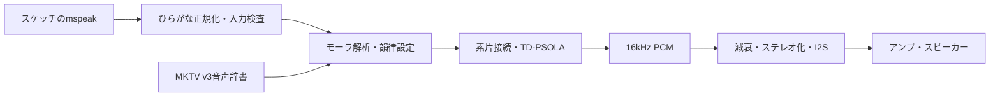

# 構造と発話の仕組み



あらかじめ録音した文章を再生する方式ではありません。
辞書にあるモーラ素片を選び、ピッチ・継続時間を調整して、その場でPCMを合成します。
TD-PSOLAは周期に対応する短い窓を重ねる処理で、声の高さと長さを調整します。
語尾・感嘆・アクセント等は記号と規則による制御です。ニューラルTTSや感情推定ではありません。

## ファイル

```text
MakoTalk/
  library.properties
  README.md / LICENSE / NOTICE.md
  src/
    MakoTalk.h                 簡易API
    MakoTalkSpeaker.cpp        I2S・初期化・発話管理
    MakoTalkText.*             かな正規化
    MakoTalkEngine.*           合成エンジン
    MakoTalkImage.*            MKTV v3検査・読込み
    MakoTalkTypes.h            素片構造体
    MakoTalkVoiceInfo.h        著作情報構造体
    port_store.h              NVSの告知済みフラグ
    MakoTalkVoiceDefault.h     既定辞書の指定
    voices/default/voice_image.h
  voices/default/
    voice_meta.json            音声・著作情報の正本
    NOTICE.md                  音声利用条件
  examples/MinimalSpeak/MinimalSpeak.ino
  docs/ / tests/
```

音声はライブラリと一緒に保持しますが、`MakoTalkVoiceDefault.h`を読み込んで使うスケッチにだけ組み込みます。
別の音声では、対応するMKTV v3の配列とサイズを`MakoTalkVoiceImage`に指定します。
データ配列は利用中ずっと有効でなければなりません。音声ごとの権利情報・条件も用意します。

## 著作情報付き辞書：MKTV v3

先頭48バイトのヘッダー、著作区画、音声区画、PCM区画を持ちます。
著作区画には音声ID、クレジット、ASCII表記、告知文と速度、権利者、規約URL、著作文書の場所、1bpp表示画像を保持します。
音声区画には素片表とカナ表を保持します。PCMは4バイト境界へ配置しています。

**CRC32は、CRC欄を0としてヘッダー・著作情報・音声表・PCMを含む辞書全体の整合性を確認します。**
著作情報検査は、必須項目と区画・形式が正しいかの確認です。
個々の音素ファイルへ別々に情報を付けるのではなく、素片一式の辞書と著作情報を一体化しています。

CRCは破損検出の仕組みです。権利の保有・配布許諾の正当性を証明するものではなく、電子署名でもありません。
意図的にデータとCRCを作り直す改変は防ぎません。
作者は、通常の利用・差し替え・再配布で出典や利用条件が取り落とされにくい構造を意図しています。

## 初期化とクレジット告知

1. 辞書の版・区画・CRC・著作情報を検査する。
2. I2Sと合成領域を用意し、著作情報をシリアルへ通知する。
3. NVSの`mktcredit/crc`に同じ辞書の告知済みフラグがなければ、クレジットを発話する。
4. 告知の合成・出力が成功した後に、告知済みCRCを保存する。
5. 同じ辞書の次回起動は自動発話を省略する。通知や配布資料のクレジットは維持する。

告知の途中打ち切りや出力失敗は成功扱いにしません。手動の`mannounceCredit()`も用意しています。
この仕組みのためにFlash全体を消去する必要はありません。
